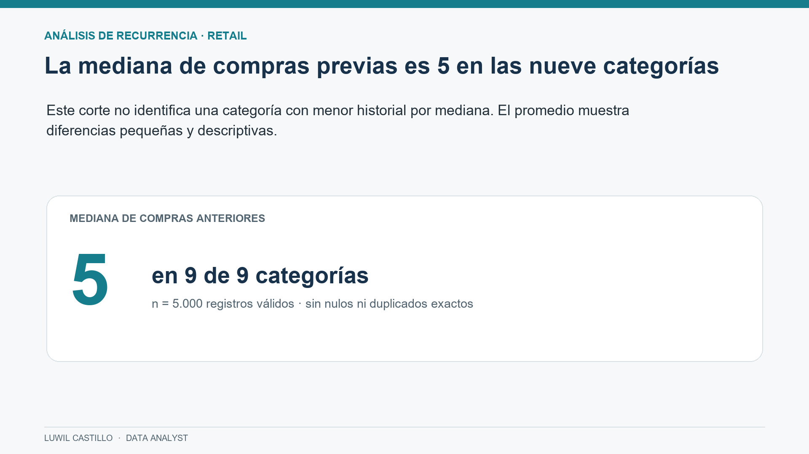
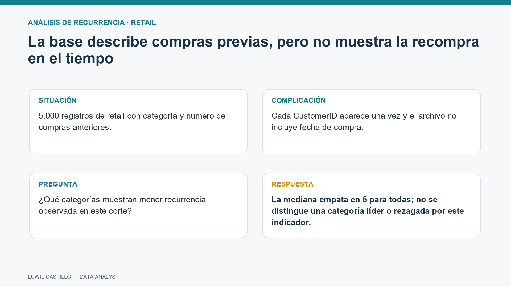
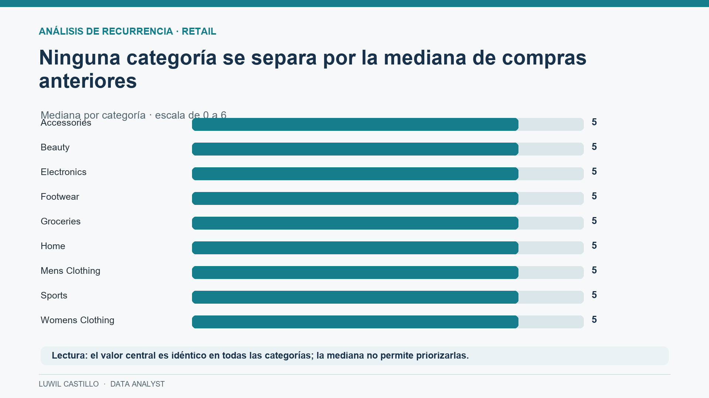
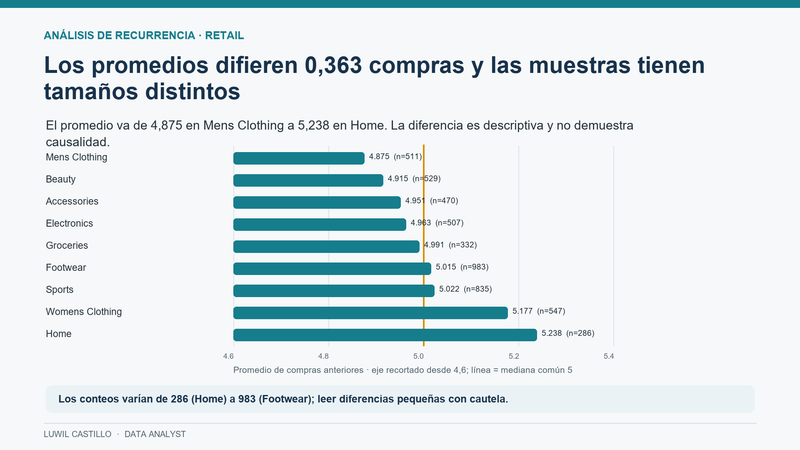
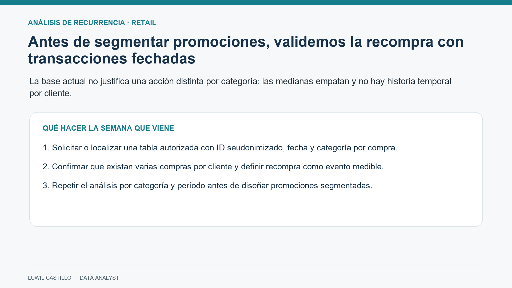

# Presentación ejecutiva | Análisis de recurrencia en retail

**Luwil Castillo · Data Analyst**

## 1. La mediana de compras previas es 5 en las nueve categorías

## 2. La base describe compras previas, pero no muestra recompra en el tiempo

## 3. Ninguna categoría se separa por la mediana de compras anteriores

## 4. Los promedios difieren 0,363 compras y las muestras tienen tamaños distintos

## 5. Antes de segmentar promociones, validemos la recompra con transacciones fechadas

**Alcance:** el dataset contiene una fila por cliente y no incluye fecha de compra. Por eso el análisis compara `PreviousPurchases` por categoría y no permite medir recompra temporal ni inferir causalidad. La recomendación es validar con transacciones fechadas y varias compras por cliente antes de segmentar promociones.